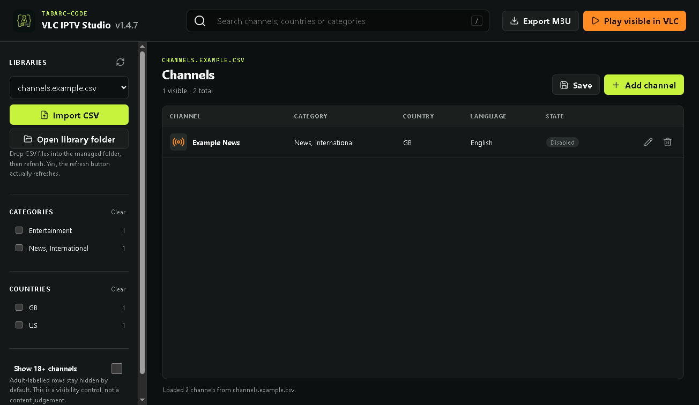

# TABARC VLC IPTV Studio

**A local-first channel organiser for people who want VLC to play the video and a calmer tool to manage the list.**

Version **1.4.7** is a clean V2 foundation by [TABARC-Code](https://github.com/TABARC-Code). It imports and edits channel CSV files, filters by category and country, keeps 18+ rows out of sight by default, exports standard M3U playlists and hands the visible selection to an installed copy of VLC.

No channels, subscriptions or access credentials are supplied. This is plumbing, not a pirate treasure map.



## What works

- Import a UTF-8 CSV through the app, or place one in its managed `libraries` folder.
- Import local M3U channel lists as disabled candidates; the app leaves original files untouched and rejects HLS segment manifests.
- Organise channels by category, country and language.
- Search instantly without changing the underlying file.
- Add, edit, enable, disable and label individual channels as 18+.
- Hide 18+ rows by default; reveal them with an explicit switch.
- Save CSV changes atomically, so an interrupted write does not casually eat the last good file.
- Export the currently visible, enabled channels as M3U.
- Launch that same view in VLC without building a shell command.
- Accept legacy `group` and `group-title` headings from the original app as `category`.

## Why it is a companion app

VLC’s Lua extension interface is useful but intentionally small: buttons, labels, text fields, lists and basic images. That is a poor fit for an accessible table editor with persistent libraries and compound filters. Studio therefore stays outside VLC, maintains ordinary CSV/M3U files, and leaves decoding, playback, volume and full-screen video to VLC.

That boundary is boring in the best way. A playlist manager should not attempt to become a media engine merely because it has discovered ambition.

## Run from source

Requirements:

- Node.js 20 or newer
- VLC from [VideoLAN](https://www.videolan.org/vlc/)

```powershell
npm install
npm test
npm start
```

The renderer has no Node access. File selection, validated reads, atomic writes and VLC launching live in Electron’s main process behind a narrow preload API.

## Start here if that sounded like fog

Open [IDIOTS-GUIDE.md](IDIOTS-GUIDE.md). The filename is deliberately blunt; the guide itself is not. It walks through installation and the CSV format without assuming that you keep a terminal under your pillow.

For exact columns and examples, see [CSV-FORMAT.md](docs/CSV-FORMAT.md). The product and interface rationale lives in [DESIGN.md](docs/DESIGN.md).

## Usage notice

Use this software only with channels and streams you own or are authorised to watch. You are responsible for applicable law, provider terms and any television licence requirements. The app supplies no feeds, bypasses no access controls and does not guarantee playback.

Keep playlists containing tokens, usernames or passwords private. This independent software is not affiliated with or endorsed by VideoLAN, any broadcaster or any service provider.

## Brand and licences

Source code is MIT licensed. The supplied TABARC/TAVARC flask artwork came from the original project and is retained here at the user’s direction; it is **not** included in the source-code licence grant. See [BRANDING.md](BRANDING.md).

Interface symbols are provided by [Lucide](https://lucide.dev/) under the ISC licence. VLC and the VLC cone are trademarks of VideoLAN; this repository does not include the cone artwork.

